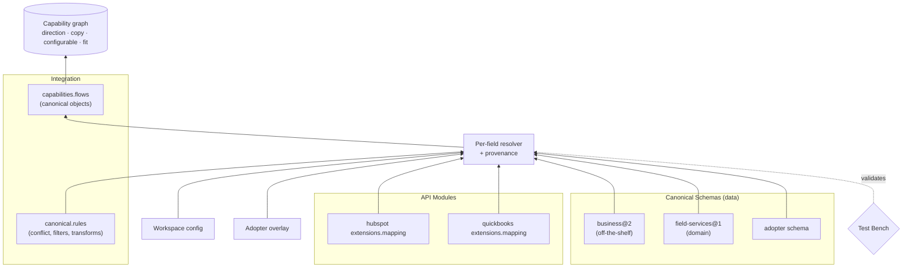

# ADR-057: Canonical Schema

**Status**: Proposed
**Date**: 2026-10-13
**Deciders**: Sean Matthews

## Context

[Capabilities](./020-capabilities.md) say *what* a piece of Frigg can do (`crm.contact.sync.bidir`). They do not say *which business objects* move or how a provider's records line up with another provider's. That lives in each integration's code. The result:

- Each HubSpot ⇄ QuickBooks Online-style integration re-derives "a HubSpot Company is a QBO Customer" by hand.
- Anything a human or an agent reads (sync direction, "What it does", "What's configurable?", a pre-install fit check) is hand-written and drifts. In one real case, a HubSpot + QuickBooks catalog card said "one way" while its flows synced in both directions.
- Agents and the capability graph cannot reason about data coverage without executing integration code.

A shared, versioned vocabulary of business objects, plus declarative per-module mappings into it, removes the drift. Two names are explicitly ruled out:

- **"Ontology"** already means layered agent context in [ADR-021](./021-ontology.md). Reusing it would confuse two unrelated concepts.
- **"Unified Model"** reads as Merge's or Apideck's product. Frigg is not shipping a unified API.

## Decision

A **Canonical Schema** is an optional, versioned, data-only package that defines canonical objects (Customer, Contact, Company, Deal, Invoice, Payment, Product, ...), their fields and their relationships. API modules map their objects onto one or more Canonical Schemas. Integrations add pair-specific rules on top. Capabilities reference canonical objects.

### Place in the taxonomy

Canonical Schema is a **new, fourth extension type** in [ADR-015](./015-extensions-taxonomy.md), not a specialization of Core, Integration, or API Module Extensions:

| | Core / Integration / API Module Extensions | Canonical Schema |
|---|---|---|
| Contents | Runtime code (routes, events, workers) | Data only (types, fields, relations) |
| Author | App, pattern, or provider author | Schema publisher (framework, adopter, domain vendor) |
| Consumed by | One surface (app, integration, module) | All three, plus the capability graph |
| Lifecycle | Code releases | Semver data contract with deprecation windows |

Making it a specialization of Core Extensions would force a runtime bundle shape (`routes`, `events`) onto pure data. It would also hide the fact that modules depend on it. It stays an *extension* (not a [Plugin](./016-plugins.md)) because it is optional: an app with no Canonical Schema behaves exactly as today. It is registered on `appDefinition.canonicalSchemas`.

The schema itself is **swappable**. Three sources are expected:

- an off-the-shelf schema that works across domains (`@friggframework/canonical-schema-business`)
- the adopter's own schema
- a domain-specific schema (e.g. `field-services` with Job, Visit, Technician, Estimate)

Several schemas may be loaded at once.

```yaml
# @friggframework/canonical-schema-business/customer.yaml
schema: business
version: 2.3.0
objects:
  Customer:
    sameAs: https://schema.org/Organization
    fields:
      displayName: { type: string, required: true }
      email:       { type: email, identity: natural }
      taxId:       { type: string }
      billingAddress: { type: Address }
      currency:    { type: currency, default: USD }
    relations:
      contacts: { to: Contact, cardinality: many }
      invoices: { to: Invoice, cardinality: many }
  Lead:
    fields: { email: { type: email, identity: natural }, source: { type: string } }
```

### Ownership split

| Concern | Owner | Example |
|---|---|---|
| Object and field definitions | Canonical Schema | `Customer.taxId` exists, type string |
| Generic meaning of a provider object | API module (`extensions.mapping`, per [ADR-019](./019-api-module-extensions.md)) | "A HubSpot Company is a Customer in `business@^2`" |
| Pair-specific rules | Integration ([ADR-018](./018-integration-extensions.md)) | Which side wins in a two-way sync, filters, transforms for this pair |
| Per-install choices | Workspace instance (`Integration.config`) | "Invoice on stage `contractsigned`" |

### Module mapping (declarative, conditional, one-to-many)

Mappings are **data, not functions**. Transforms are *named* functions that a mapping refers to by name, so the capability graph and fit check can read every mapping without running code. Conditional and one-to-many mappings are supported from day one.

```yaml
# @friggframework/api-module-hubspot/mappings/business.yaml
schema: business@^2
objects:
  contact:
    - when: { field: lifecyclestage, in: [customer, evangelist] }
      to: Customer
      identity: [externalIds.hubspot, email]
      fields: { email: email, firstname+lastname: { to: displayName, transform: joinName } }
    - when: { field: lifecyclestage, in: [lead, subscriber, marketingqualifiedlead] }
      to: Lead
      fields: { email: email, hs_analytics_source: source }
  company:
    - to: Customer
      fields: { name: displayName, domain: website, hs_tax_id: taxId }
      ops: [read, create, update, subscribe]   # informational; ADR-045 traits are authoritative
```

```javascript
// @friggframework/api-module-quickbooks/index.js
module.exports = {
    Definition: require('./definition'),
    Api: require('./api'),
    extensions: {
        webhooks: require('./extensions/webhooks'),
        mapping: {
            schemas: { business: require('./mappings/business.yaml') }, // invoice Line[] → InvoiceLine + Product (one-to-many)
            transforms: { toQboDate: (v) => v.slice(0, 10), splitLine: require('./transforms/split-line') },
        },
    },
};
// definition.js references it: Definition.mappings = { business: 'extensions.mapping' }
```

### Integration rules and capability references

```javascript
class HubSpotQuickBooksIntegration extends IntegrationBase {
    static Definition = {
        name: 'hubspot-quickbooks', version: '2.1.0',
        modules: { hubspot: { definition: HubSpot }, quickbooks: { definition: QBO } },
        canonical: {
            schema: 'business@^2',
            rules: {
                Customer: { conflict: { taxId: 'quickbooks', displayName: 'hubspot', default: 'lastWriteWins' },
                            overridable: ['displayName'] },
                Invoice:  { filter: { source: 'hubspot.deal', where: { dealstage: '{{config.invoiceStage}}' } } },
            },
        },
        capabilities: {
            'crm.customer.sync.bidir': {
                surface: 'sync',
                flows: [
                    { from: 'hubspot', to: 'quickbooks', object: 'Customer', trigger: 'webhook' },
                    { from: 'quickbooks', to: 'hubspot', object: 'Customer', trigger: 'webhook' },
                ],
            },
            'billing.invoice.create': {
                surface: 'sync',
                flows: [{ from: 'hubspot', to: 'quickbooks', object: 'Invoice', source: 'Deal', conflict: 'createOnly' }],
            },
        },
    };
}
```

Because flows name canonical objects, the following are **derived, not written**:

- **Direction:** ⇄ if any object has flows both ways, → otherwise. This prevents the "one way" bug by construction.
- **"What it does" copy:** generated from the flows.
- **The fit check:** user intent is parsed into canonical objects and flows, then matched against the declared flows.

### Conflict layering (per field)

Values and settings resolve **per field, not per object**, highest precedence first:

1. **Workspace instance settings** (`Integration.config`)
2. **Adopter overlay** (an app-level mapping patch)
3. **Module mapping** (`extensions.mapping`)
4. **Schema defaults**

The resolver records the winning layer for each field as **provenance** (`{ field: 'Customer.displayName', layer: 'workspace', ref: 'config.canonical.Customer.displayName' }`). Provenance has two consumers:

- **"What's configurable?":** the list is exactly the fields that are overridable at the workspace layer.
- **Fit-check reasons:** e.g. "taxId comes from QuickBooks per module mapping; not overridable."

### Versioning

- A mapping declares the schema range it supports (`business@^2`). Load fails loud if no loaded schema satisfies the range.
- During a major migration, the previous major (`business@1`) stays loaded alongside the new one. Integration records pinned to the old range keep resolving until they are migrated per [ADR-013](./013-integration-version-migrations.md) and [ADR-030](./030-integration-versioning.md).
- **Test Bench** fails the build when a mapping, rule, or capability flow references a field or object that was removed, or that is absent from the resolved schema version.

### Relationship to ADR-046 (PR #648)

[PR #648](https://github.com/friggframework/frigg/pull/648) proposes ADR-044 (canonical objects in the sync engine), ADR-045 (Capability Traits) and ADR-046 (Canonical Models). This ADR builds on them and does not replace them:

- **Same goal, different layer.** ADR-046 ships per-category canonical models as code (`Sync` classes with `moduleMap`/`reverseModuleMap`, forked via `extend()`). This ADR defines the data-only contract those models can be published as. A Canonical Schema object can be generated from, or back, an ADR-046 model.
- **Packaging.** ADR-046 rejects a single universal model. `business` here is one schema package among several and can be split per category (`crm`, `accounting`, ...) to match ADR-046 without changing anything else in this ADR.
- **Forks and skew.** ADR-046's `addKeys`/`overrideMap`/`removeKeys` fork, and its declared `skew`, correspond to the adopter overlay layer and to provider-specific fields here. Where both exist, ADR-046's terms win.
- **Traits, not ops.** What a provider can do (`ops`, `createOnly`) should be read from ADR-045 traits (`write.createOnly`, `write.upsertByExternalKey`, ...) rather than declared again in mappings. `ops` here is informational only.
- **What this ADR adds:** a fourth extension type, declarative and conditional module mappings readable without running code, per-field merge order with provenance, schema ranges checked by Test Bench, and canonical-object `flows` on ADR-020 capabilities.

## Architecture



## Consequences

### Positive
- Direction labels, product copy, configurable lists and fit-check reasons come from one source of truth, so hand-written drift is eliminated.
- "HubSpot Company → Customer" is written once in the module and reused by every integration that includes HubSpot.
- Declarative mappings are readable by agents, the capability graph and docs generators without executing code.
- Domains and adopters can bring their own schema without forking the framework.

### Negative
- A new artifact type to author, version and validate. Mapping authors must learn the schema and the condition DSL.
- Declarative mappings cannot express every edge case. Complex logic moves into named transforms, which are opaque to static analysis.
- Keeping two major versions loaded raises memory and test-matrix cost during migrations.

### Neutral
- Integrations that skip Canonical Schemas work exactly as today. Adoption is incremental.
- ADR-020 gains an optional `flows` field on capabilities. ADR-019 gains a reserved `extensions.mapping` name.

## Alternatives Considered

1. **Bake one schema into core.** This is simple and gives a single vocabulary. It was rejected because domains differ (field services vs. SaaS billing), so one schema bloats core and blocks adopters who already have their own model. It also violates ADR-015's rule that functionality on top of the framework is optional.
2. **Leave mapping to each integration.** This is the status quo. Each pair re-implements object meaning, nothing is reusable, and the capability graph cannot see data coverage. This is the source of the drift described in Context.
3. **Adopt a third-party unified API's schema (Merge, Apideck).** These schemas are mature for CRM, accounting and ticketing, but they carry licensing and roadmap dependence on a vendor and their versioning is not under our control. They also lack domain-specific objects. We instead *align* field names with them where practical, so that a unified API can be wrapped as a module whose mapping is near 1:1.

## Cross-references

- [EXTENSIONS-TAXONOMY](./015-extensions-taxonomy.md): adds Canonical Schema as a fourth extension type
- [PLUGINS](./016-plugins.md): why this is an extension, not a plugin (optional)
- [INTEGRATION-EXTENSIONS](./018-integration-extensions.md): integration-owned pair rules
- [API-MODULE-EXTENSIONS](./019-api-module-extensions.md): `extensions.mapping` export
- [CAPABILITIES](./020-capabilities.md): capability `flows` reference canonical objects
- [ONTOLOGY](./021-ontology.md): distinct concept (agent context). The name is deliberately avoided here
- [INTEGRATION-TEMPLATES](./023-integration-templates.md): templates can ship pre-wired `canonical.rules` for a category
- [ADR-044, ADR-045, ADR-046 (PR #648)](https://github.com/friggframework/frigg/pull/648): sync canonical objects, capability traits, canonical models
- [INTEGRATION-VERSIONING](./030-integration-versioning.md), [ADR-013](./013-integration-version-migrations.md): pinning and migrating schema ranges

## Open questions

1. **Condition and filter language.** Should it be a minimal built-in DSL (`when: { field, in }`) or JSONLogic? Lean: start with the minimal DSL and add an escape hatch to named predicates.
2. **Where the off-the-shelf schema lives.** Should `canonical-schema-business` be maintained by the framework or by the community, and how closely should it track schema.org and the Merge/Apideck field names?
3. **Identity resolution.** Is fuzzy matching on natural keys (email, domain) a schema concern, a module concern, or a separate extension?
4. **Provenance storage.** Should provenance be computed at load time only, or persisted per Integration record for audit?
5. **Cross-schema mapping.** Can one module map to `business` and `field-services` at once, and how are overlapping objects reconciled?

## References

- schema.org vocabulary (`sameAs` targets for canonical types)
- Merge and Apideck common models (field-name alignment only)
- OpenAPI `x-` extensions and APIs.json, used by the capability graph to source module mappings
- Numbering note: this ADR takes 057. Open PRs claim ADR numbers up to 056 (#670), so 057 is the next free number.
