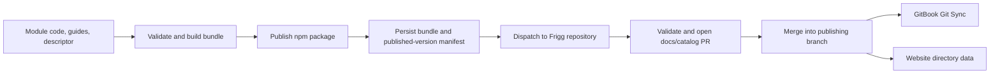

# ADR-065: Release-Versioned Module Documentation and Catalog Publishing

**Status**: Accepted  
**Date**: 2026-10-25  
**Deciders**: Sean Matthews

## Context

Frigg API modules have their own packages, release cadence, and repository:
[`friggframework/api-module-library`](https://github.com/friggframework/api-module-library).
The Frigg repository owns the public documentation under `docs/`, with
`.gitbook.yaml` selecting that directory, and the marketing site under `website/`.
The module library's `main` release workflow currently runs `npx auto shipit`.

Module documentation is maintained separately from the code it describes. Existing
navigation mixes `api-modules/` and `api-module-library/` paths, and does not establish
which package release a page describes. Independently generated pages can improve
coverage, but do not establish a reliable relationship between released code and docs.

We also want a public directory on friggframework.org where developers can discover
API modules and, later, other Frigg extensions. Maintaining separate descriptions,
compatibility claims, and release information for GitBook and the directory would
create another source of drift.

Terraform's provider registry provides relevant prior art: documentation lives with
the provider and is published by release version. Backstage's catalog and TechDocs
demonstrate keeping component descriptors and documentation alongside source code.
We can adopt those patterns without adopting either platform.

## Decision

### 1. Module authors own documentation beside the code

Each API module in `api-module-library` owns:

- A schema-validated catalog descriptor with a stable ID, description, provider,
  maintainers, license, category, support status, and source/support links.
- Authored documentation and examples under its package directory.
- Generated reference derived from the module's documented public exports, types,
  JSDoc, or explicit schemas, using a pinned generator and template version.

The descriptor references package metadata rather than duplicating package name,
version, and declared runtime compatibility. The release builder resolves those
fields from the released package and records them in the output. Compatibility
that cannot be inferred must be explicitly declared and validated; absence means
unknown, not compatible.

Do not claim support for an entire provider API based on its upstream OpenAPI
specification. Document the methods and behavior actually exposed by the Frigg
module. Methods without usable annotations require authored reference until they
can be generated reliably.

AI tools may draft prose and examples. Reviewed source files and deterministic
generation determine published documentation. Module imports or provider API calls
must not be required merely to discover metadata in the destination repository.

### 2. Every published package version has a documentation bundle

Build a bundle for each package version containing GitBook-compatible Markdown,
assets, a navigation fragment, and a resolved catalog record. Its manifest records:

- Schema version, stable module ID, npm package name, and exact package version.
- Source repository, immutable source commit, package path, and release channel.
- Package integrity and bundle digest, plus generator/template versions.
- Declared compatibility, exported extensions, and links to release notes.

The release process must establish the exact source used for the package, including
version changes made by the release tool. Do not assume the workflow's initial
checkout SHA is the released source. Capture the packages and versions actually
published; a successful `auto shipit` invocation alone can also represent no release.

Persist the bundle and release manifest as durable, version-addressable release
assets or an equivalent durable store. Short-lived Actions artifacts alone are
insufficient for historical docs and retrying delivery. The pilot must establish
how `auto` exposes the published package set and attaches assets before automation
is enabled for all modules.

Bundle identity is `(package name, package version)`. Re-delivery with the same
digest is a no-op; different content for that identity is rejected. Documentation
corrections use an explicit, reviewed docs revision recording the original package
identity and correction source. They do not silently replace the release snapshot.

### 3. Successful package publication triggers delivery to Frigg



1. During release preparation, validate and build documentation for the exact
   candidate package. Missing required documentation or invalid metadata blocks
   publication of that candidate.
2. After confirming successful npm publication, persist its bundle and emit a
   `repository_dispatch` event to `friggframework/frigg`. A batched event may contain
   multiple independently versioned packages. Failed or skipped publications must
   not be advertised as released.
3. A receiving workflow validates the event, verifies the released package identity
   and trusted bundle provenance, and retrieves the bundle from an allowlisted
   repository/store. Event payloads identify releases; they cannot supply arbitrary
   checkout targets, download URLs, scripts, or output paths.
4. The workflow creates or updates a bot PR containing the versioned pages,
   generated navigation, resolved catalog records, and release provenance. It runs
   metadata, Markdown, link, and navigation validation before merge.
5. Merging into the branch configured for publication lets the existing GitBook
   sync and website deployment publish the changes. Each publisher reports its own
   outcome; merging the PR does not itself prove both destinations are live.

Use a GitHub App with narrowly scoped installation permissions for the cross-repo
dispatch and PR operations. A repository's default `GITHUB_TOKEN` is not a general
cross-repository credential. Keep destination write credentials out of untrusted
module build jobs, and do not execute bundle contents in the receiver.

Start with reviewed PRs. Automatic merging of deterministic updates can be adopted
later under explicit repository rules once the pilot proves the checks reliable.

### 4. Delivery is repeatable and recoverable

Package publication and documentation publication are separate recorded outcomes.
If delivery fails after npm publication, retain the published package, report docs
as pending/failed, and retry delivery without republishing the package. Do not make
the whole release job the only retry mechanism.

Deduplicate by package/version and bundle digest, update an existing open PR on
retry, and serialize changes to shared navigation and catalog indexes. Recompute
shared outputs against the current publishing branch before merge so concurrent
module releases cannot overwrite one another. Provide a manual backfill command
using the same validation and delivery path.

This ADR does not create a recurring reconciliation service. Persistent delivery
state and observable failures are required; the storage and monitoring mechanism
will be selected during the pilot.

### 5. Versions and stable URLs are per module

Use one canonical destination structure for new generated pages:

```text
docs/api-modules/<module-id>/versions/<package-version>/
docs/api-modules/<module-id>/README.md
website/data/catalog/<module-id>.json
```

The module landing page points to the latest eligible stable release, with its
exact version and compatibility shown prominently. Each released version has a
stable address and remains available independently of Frigg core releases.
Prereleases are explicitly labeled and cannot advance the stable pointer. An
older release delivered later cannot move the pointer backward; selection uses
semantic version precedence within the stable channel.

Retain every imported release snapshot, but keep GitBook's primary navigation
focused on current modules, with version indexes linking historical snapshots.
This avoids making every patch release a top-level navigation entry. Native
GitBook version selectors or separate Spaces are optional presentation choices,
not required for package version identity.

Legacy paths need an explicit mapping to canonical module IDs and redirects or
preserved landing pages where supported. Generate only the module-owned portion
of `SUMMARY.md`, preserving unrelated navigation. Do not rewrite existing module
pages or delete old paths as an incidental part of the first import.

### 6. Minimum documentation standard for each module

Organize content around the Diátaxis distinction between tutorials, how-to guides,
reference, and explanation. Required coverage may share pages when that reads
better; empty template pages do not satisfy the standard.

| Area | Required coverage | Ownership |
|---|---|---|
| Overview | Provider, supported use cases, coverage gaps, maturity, maintainers | Authored descriptor and prose |
| Installation and compatibility | Exact package installation, supported Node/Frigg versions, provider API version where relevant | Package metadata plus authored guidance |
| First successful call | Minimal runnable setup and example, expected result, prerequisites | Authored and checked example |
| Authentication | Supported schemes, app registration, scopes, redirect setup, credential lifecycle and refresh behavior | Authored, verified against implementation |
| API reference | Public methods, parameters, return shapes, errors, examples, and provider reference links | Generated where reliable; authored otherwise |
| Operating behavior | Pagination, rate limits, retries, error handling, and relevant webhook setup/signature behavior | Authored and implementation-linked |
| Extensions and artifacts | Exported bundles, binding examples, prerequisites, and provider-side setup where applicable | Export metadata plus authored guides |
| Changes and support | Release notes, breaking changes, migrations, known limitations, support route | Release-linked and authored |

Mark inapplicable features explicitly. Distinguish provider limits from behavior
implemented by the module. Check examples against the candidate package using
fixtures or mocks; live provider smoke tests may supplement those checks when
credentials are available, but docs publication must not require production
credentials. Validate links and navigation and reject placeholder required content.

### 7. The same records feed a public directory

Begin with a static directory on friggframework.org, consuming the resolved release
records. Initial entries represent API module packages. Keep package identity
separate from entry kind so the catalog can later include plugins, core/integration
extensions, templates, and artifacts using the existing ADR taxonomy.

An API module's exported extensions are features of that package and version;
they are not automatically separate installable directory entries. Display
capabilities only when declared and supported, and distinguish declared
compatibility from versions actually tested.

Each entry exposes its description, provider/category, maintainer, license,
support status, stable version, compatibility, capabilities, and install, docs,
source, and support links. Search and filters can operate on generated JSON without
introducing a database. Publication does not automatically confer an official,
partner, or verified badge; any such labels require a separate curation policy.

Payments, ratings, accounts, submissions, and commercial marketplace mechanics
are outside this decision. The directory establishes a reusable catalog contract
without committing to those product features.

### 8. Roll out with one module

Pilot one maintained module with real authentication guidance and checked examples.
Demonstrate a release, a duplicate event, an out-of-order release, a prerelease,
failed delivery followed by retry, and two releases updating shared indexes.
Verify the resulting GitBook pages and website records before expanding coverage.

Adopt existing modules incrementally. Historical versions may be backfilled only
from identifiable release sources; do not label current generated content as
documentation for an older release. The proposal does not assert that existing
modules already meet this standard.

## Consequences

### Positive

- Documentation describes a specific released module rather than an unspecified
  repository state.
- Module maintainers review code, examples, and documentation together.
- GitBook and the directory share identity, compatibility, and release data.
- Delivery failures are recoverable without republishing packages.
- The catalog can grow with Frigg's extension taxonomy.

### Negative

- Authors must maintain guides and annotations; reference generation cannot supply
  provider setup instructions or explain undocumented behavior.
- Durable bundles, cross-repo permissions, shared-index updates, and historical
  pages add publishing infrastructure and storage.
- Reviewed docs PRs introduce a delay between package availability and public docs.
- Canonical IDs and paths require deliberate migration of legacy links.

### Neutral

- GitBook remains the documentation publisher and npm remains the package registry.
- The website initially consumes static catalog files.
- This ADR establishes the contract; implementation requires
  changes in both repositories and publishing configuration.

## Alternatives Considered

- **Generate pages from the latest default branch on every deploy.** Does not
  establish what a published package supports and can expose unreleased behavior.
- **Generate all prose at release time with an AI model.** Useful for drafts, but
  insufficient for repeatable output and reviewed claims about authentication,
  compatibility, and supported APIs.
- **Write directly to GitBook through its API.** Bypasses the existing Git workflow
  and makes generated changes and release provenance harder to review together.
- **Push commits directly to the publishing branch.** Simpler delivery, but reviewed
  PRs provide a better initial boundary for navigation and catalog changes.
- **Sync directly from each module repository into separate GitBook Spaces.** May
  suit a smaller catalog, but complicates shared navigation and does not supply the
  website catalog contract by itself.
- **Adopt Backstage or build a full marketplace immediately.** Both introduce more
  product and operational scope than release-linked docs and a static directory need.

## Related

- [ADR-014: One Numbered ADR Register](./014-consolidate-adr-register.md)
- [ADR-015: Extensions Taxonomy](./015-extensions-taxonomy.md)
- [ADR-019: API Module Extensions](./019-api-module-extensions.md)
- [ADR-020: Capabilities](./020-capabilities.md)
- [ADR-022: Artifacts](./022-artifacts.md)
- [ADR-023: Integration Templates](./023-integration-templates.md)
- [API module library release workflow](https://github.com/friggframework/api-module-library/blob/main/.github/workflows/release.yml)
- [Terraform provider documentation and release publishing](https://developer.hashicorp.com/terraform/registry/providers/docs)
- [Backstage: Creating and publishing TechDocs](https://backstage.io/docs/features/techdocs/creating-and-publishing/)
- [GitHub Actions: Triggering a workflow](https://docs.github.com/en/actions/how-tos/write-workflows/choose-when-workflows-run/trigger-a-workflow)
- [GitBook Git Sync](https://www.gitbook.com/features/git-sync)
- [Diátaxis](https://diataxis.fr/start-here/)
