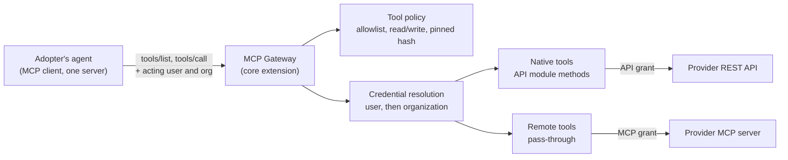

# ADR-070: MCP Gateway

**Status**: Proposed
**Date**: 2026-11-13
**Deciders**: Sean Matthews, Daniel Klotz

## Context

Adopters are putting agents inside their products. Such an agent needs tools that reach the
same external systems the adopter's Frigg app already connects to, and it needs them for the
acting user, with that user's credentials.

The case that raised this: an adopter with a Frigg app (HubSpot and Salesforce sync, firm-level
connections) is adding connectors to its in-product agent. The first three are a Slack
"post a message" action, and two data providers that publish remote MCP servers and license
per seat. The adopter's first plan was to build an MCP client and a second encrypted token
store inside its own backend, because Frigg has no MCP support. That gives the adopter two
credential stores, two connect flows and two connection lists for what the user sees as one
list of integrations.

It also forces a choice per provider that should not be visible above Frigg: "use their MCP
server" or "use their API". Some providers offer only one. Some offer both, and each is better
at a different job.

### What exists

| Piece | State |
|---|---|
| [ADR-006](./006-integration-router-v2.md) proxy endpoints (`/api/entities/:id/proxy`) "for MCP/tool-calling use cases" | Accepted. No proxy route was found in `packages/core/integrations/integration-router.js` |
| [ADR-017](./017-core-extensions.md) `@friggframework/extension-mcp-server`, "exposes the app's capabilities as MCP tools" | Proposed. Named in a table, not designed |
| [ADR-020](./020-capabilities.md) `mcp-tool` capability surface | Proposed |
| Backend-to-backend caller identity (`x-frigg-api-key`, `x-frigg-appuserid`, `x-frigg-apporgid`) | Shipped (`packages/core/user/use-cases/get-user-from-x-frigg-headers.js`) |
| Per-user and per-organization ownership of `Entity` and `Credential` (`userId` on both) | Shipped |
| Field-level encryption of `Credential.data` | Shipped |

### What is missing

1. **Frigg as a client of someone else's MCP server.** Nothing above covers it.
2. **MCP authorization as a client.** `OAuth2Requester` (`packages/core/modules/requester/oauth-2.js`)
   has no PKCE, no authorization-server discovery, no client registration and no `resource`
   parameter. The MCP authorization specification requires PKCE and the `resource` parameter,
   and remote servers are found through discovery.
3. **One tool surface.** There is no place where "tools we wrote on top of an API module" and
   "tools a provider's MCP server offers" are merged, filtered and served for one caller.
4. **Tool policy.** An MCP server describes its own tools. The specification says a client
   must not trust those descriptions unless the server is trusted. Nothing in Frigg lets an
   adopter decide which remote tools are allowed and which of them change data.

### A token is good for one thing

The MCP authorization specification binds a token to the server it was requested for
(RFC 8707 resource indicators), and requires the server to reject tokens issued for any other
resource. Treat a token obtained for a provider's MCP server as unusable on that provider's
REST API, and the reverse. Where a provider is used both ways, that is two consents and two
credentials.

## Decision

Add an **MCP Gateway** to Frigg: one MCP endpoint on a Frigg app that serves a merged,
filtered tool list for the calling user and routes each tool call either to code in an API
module or to a remote MCP server, using credentials Frigg already holds.



### 1. Packaging

The gateway ships as a Core Extension, `@friggframework/extension-mcp-gateway`. It takes the
place of the `extension-mcp-server` entry in ADR-017, which covered only the native half.
An app that does not load it gets no new routes and no new behavior.

The endpoint speaks MCP over Streamable HTTP in stateless mode, so it runs on the existing
Lambda and API Gateway deployment with no session store.

### 2. Two tool sources

| | Native tool | Remote tool |
|---|---|---|
| Defined by | A capability with surface `mcp-tool` on an API module or integration (ADR-020) | The provider's MCP server |
| Runs | Frigg code, calling the provider's API | The provider's server; Frigg passes the call through |
| Credential | API grant | MCP grant |
| Maintained by | Us | The provider |
| Good for | Exact writes, actions that need confirmation, anything also used by sync or webhooks | Long-tail reads the provider keeps current |

The caller cannot tell the two apart. Both appear as tools named `{connector}__{tool}`.

### 3. A remote MCP server is an API module

A remote MCP server is declared as an API module so that connect, storage, refresh, encryption
and the management API all work unchanged. A new requester, `McpRemoteRequester`, extends
`OAuth2Requester` with the client side of MCP authorization:

- Protected-resource metadata discovery (RFC 9728), then authorization-server metadata (RFC 8414).
- Client identification, tried in this order: credentials registered ahead of time with the
  provider; a client ID metadata document served by the Frigg app; dynamic client registration
  (RFC 7591).
- PKCE with `S256` on every authorization.
- The `resource` parameter on authorization and token requests (RFC 8707).
- Tokens stored in `Credential.data`, encrypted like any other credential. The refresh rules
  in [ADR-031](./031-concurrent-oauth-credential-refresh.md) and
  [ADR-042](./042-in-process-single-flight-token-refresh.md) apply.

```javascript
// Illustrative. Names are examples, not a real provider's.
module.exports = {
    Definition: {
        moduleName: 'mcp-exampledata',
        provider: 'exampledata',          // groups grants for one provider (section 4)
        requester: 'mcp-remote',
        mcp: { url: 'https://mcp.exampledata.com/mcp' },
        ownership: 'user',                // each user connects their own seat
    },
};
```

Every outbound request to a remote server, including the discovery fetches, goes through an
HTTPS-only client that refuses private and link-local address ranges and caps response size.
Server URLs come from module definitions only. A user cannot supply one.

### 4. Grants

A **grant** is one `Entity` with its `Credential`, exactly as today. A provider used both ways
has two entities under two module names (for example `hubspot` and `mcp-hubspot`), each with
its own consent. Modules declare a shared `provider` key so an adopter's UI can show one tile
for both.

When a native tool and a remote tool do the same thing, the native tool is served and the
remote one is withheld. The adopter states this in gateway config (`supersedes`). The agent
sees one tool per action.

Neither grant replaces the other. They differ on a more useful axis than protocol:

| | API grant | MCP grant |
|---|---|---|
| Usually owned by | The organization, set up by an admin | Each user |
| Runs when | No user is present: sync, webhooks, schedules. Also for native tools | A user asks the agent |

### 5. Caller identity and credential resolution

Version 1 accepts backend-to-backend calls only: the app's shared secret plus
`x-frigg-appuserid` and `x-frigg-apporgid`. The adopter's backend is the MCP client and states
who is acting. End-user MCP clients connecting to the gateway directly are out of scope.

For each connector the gateway looks for a grant in this order:

1. An entity owned by the acting individual user.
2. An entity owned by the acting organization, if the connector allows organization ownership.
3. None: the tool is not listed, and a direct call returns `connection_required` (section 7).

### 6. Tool policy

The adopter, not the provider, decides what the agent may call. Gateway config holds, per
connector:

- **An allowlist.** A remote tool not on the list is never served.
- **An access class per tool**, `read` or `write`, set by the adopter. A provider's own
  annotations are ignored for this purpose.
- **A pinned hash** of each remote tool's name, description and input schema, taken when the
  tool was reviewed. If the server later returns a different definition, the tool is withheld
  and a `gateway.tool.drift` event is raised. A person reviews and re-pins.

```javascript
extensions: [
    mcpGateway({
        connectors: {
            exampledata: {
                module: 'mcp-exampledata',
                tools: {
                    search_companies: { access: 'read', sha256: '9f2c…' },
                },
            },
            slack: {
                module: 'slack',
                tools: {
                    'notifications.message.send': { access: 'write' },
                },
            },
        },
        limits: { timeoutMs: 20000, maxResultBytes: 262144 },
    }),
],
```

The gateway reports the access class on each tool it lists. It does not enforce a
confirmation step. That belongs to the caller (see Non-goals).

### 7. Responses

- Every result carries `_meta.frigg` with the connector, the source (`native` or `remote`) and
  the access class. Content from a remote server is marked as untrusted third-party content so
  the caller can treat it as data.
- Results larger than `maxResultBytes` are cut and marked as cut. A caller must never read a
  cut result as a complete one.
- A `write` call is never retried by the gateway.
- A call to a connector with no usable grant returns a structured error:
  `{ code: 'connection_required', connector, provider, ownership, authorizeUrl }`. The
  caller shows a connect control. The agent's model never handles a token or a credential.
- `GET /api/gateway/connectors` returns the directory for the acting user: every configured
  connector, who owns its grant, and whether it is connected. This is what an adopter's
  integrations page renders.

### 8. Telemetry

Each tool call emits a usage event under [ADR-011](./011-integration-telemetry-and-usage-tracking.md):
connector, tool, source, access class, acting user and organization, duration, result size and
outcome. Arguments and results are not logged by default, because a query can carry personal
data.

### Non-goals

- **No agent loop.** Frigg does not call a model.
- **No approval logic.** Confirmation before a write, undo, and rules such as "no write after
  reading untrusted content" stay in the caller. The gateway supplies the facts those rules need.
- **No user-supplied server URLs** and no public registry.
- **Tools only in version 1.** MCP resources, prompts, sampling and elicitation are not passed
  through.
- **No use of an MCP grant for sync, webhooks or schedules.**

## Consequences

### Positive

- An adopter's agent needs an MCP client for one trusted server, with static authentication.
- One credential store, one connect flow and one directory for integrations and agent tools.
- "Their MCP server or their API" becomes a per-connector detail that can change later without
  touching the agent.
- Tokens stay inside Frigg. The adopter's backend and the model never hold a provider token.
- Native tools reuse API modules that already exist, and any managed agent runtime that takes
  tools over MCP can use the same endpoint.

### Negative

- Every tool call inside an agent run gains a network hop, and Lambda cold starts add to it.
- `McpRemoteRequester` is new security-sensitive code: discovery, registration and outbound
  fetches to hosts a module names.
- Pinned hashes mean a provider's routine tool update withholds the tool until someone reviews it.
- A provider used both ways asks the user for consent twice.

### Neutral

- The proxy endpoints in ADR-006 remain a separate, lower-level surface. The gateway does not
  depend on them.
- ADR-017's table entry for `extension-mcp-server` should point here.

## Comparable tools

Products on the market already do parts of this. They fall into four groups. The descriptions
below come from each vendor's public documentation in November 2026. None was tested for this
ADR, and these products change quickly, so check the linked pages before relying on a detail.

| Group | Examples | What they do | Same as this ADR | Different from this ADR |
|---|---|---|---|---|
| Cloud agent gateways | Amazon Bedrock AgentCore Gateway with AgentCore Identity | One MCP endpoint in front of targets (OpenAPI, Lambda, MCP servers). Outbound OAuth to targets, including user-consent flows, with tokens held in a vault | The merged endpoint, outbound authorization per user, a credential vault, remote MCP servers as targets | A managed service tied to one cloud's agent stack. Tools only: no sync, webhooks or schedules on the same connections |
| Agent tool platforms | Composio, Arcade, Pipedream Connect | Hosted catalogs of prebuilt tools with per-user OAuth, exposed to an agent as an MCP endpoint | Per-user credentials handled server-side; the agent never holds a provider token | The vendor hosts the tokens and authors most of the tools. The adopter's existing integrations and their credentials live elsewhere |
| Embedded integration platforms with an agent surface | Nango, Paragon ActionKit, Merge Agent Handler | An integration platform for a SaaS product's end users that also serves its actions as agent tools, scoped to one user's connection | The closest match: one set of connections serves both product integrations and agent tools | Mostly hosted by the vendor. Tools are ones written on the provider's API; passing a provider's own MCP server through is not their main model |
| MCP infrastructure gateways | Cloudflare MCP server portals, Docker MCP Gateway, IBM ContextForge, Envoy AI Gateway | Put many MCP servers behind one endpoint with access policy, tool filtering and logging | Aggregation, tool filtering, central logging | Built for an organization's own staff and developer tools. No notion of an adopter's end users, each with their own provider grant, and no tools built from API modules |

### What this ADR takes from them

- **One endpoint, filtered per caller.** Every group does this, and the infrastructure
  gateways warn against passing every tool through unfiltered. Section 6 follows that advice.
- **Credentials resolved server-side for the acting user.** The agent tool platforms and
  AgentCore Identity all work this way. Section 5 does the same with Frigg's existing user and
  organization model.
- **A vault with consent flows per provider.** This is what `McpRemoteRequester` and the
  existing credential store provide together.

### What is different here

1. **One connection store for integrations and agent tools.** Only the embedded integration
   platforms share this. An adopter that already runs sync on Frigg does not add a second vendor
   or a second set of tokens.
2. **It runs in the adopter's own cloud account**, with the adopter's encryption keys. Most of
   the products above hold the tokens on the vendor's side.
3. **Native and remote tools in one list, with an explicit rule for overlap** (`supersedes`).
   The agent tool platforms lean to tools they wrote; the infrastructure gateways lean to
   pass-through. This design treats both as first-class and lets the adopter choose per action.
4. **The adopter sets the access class and pins each remote tool's definition.** Filtering is
   common in these products. Pinning a reviewed definition and withholding the tool when it
   changes is stated here as a requirement.

### Sources

- AgentCore Gateway: [outbound authorization](https://docs.aws.amazon.com/bedrock-agentcore/latest/devguide/gateway-outbound-auth.html), [MCP server targets](https://docs.aws.amazon.com/bedrock-agentcore/latest/devguide/gateway-target-MCPservers.html)
- Merge Agent Handler: [how it works](https://docs.merge.dev/merge-agent-handler/how-it-works)
- Paragon: [MCP support without hosting servers](https://www.useparagon.com/blog/add-mcp-support-without-hosting-servers)
- Nango: [MCP servers for agent API integrations](https://nango.dev/blog/best-mcp-servers-for-agent-api-integrations)
- Arcade: [the MCP gateway pattern](https://blog.arcade.dev/mcp-gateway-pattern), [Arcade and Composio compared](https://arcade.dev/compare/arcade-vs-composio/)
- Cloudflare: [MCP server portals](https://developers.cloudflare.com/cloudflare-one/access-controls/ai-controls/mcp-portals)
- Docker: [MCP Gateway](https://www.docker.com/blog/docker-mcp-gateway-secure-infrastructure-for-agentic-ai/)
- IBM: [ContextForge](https://github.com/ibm/mcp-context-forge)
- Envoy AI Gateway: [MCP gateway](https://aigateway.envoyproxy.io/docs/0.6/capabilities/mcp/)

## Alternatives Considered

1. **Adopt one of the comparable tools next to Frigg.** Workable, and the right call for an
   adopter with no Frigg app. For one that has a Frigg app it means a second vendor, a second
   credential store and a second connect flow, which is the problem this ADR starts from. The
   cloud agent gateway is the strongest candidate, and nothing here prevents putting it in
   front of this gateway later as one more MCP target.

2. **The adopter builds its own MCP client and token store.** Fastest for one adopter. It
   duplicates what Frigg exists to provide, and every adopter with an agent repeats it.
3. **Frigg as a token vault only**: the adopter's backend asks Frigg for a token and calls the
   remote server itself. Rejected because tokens leave Frigg, and tool policy and the merged
   tool list would have to be rebuilt by each adopter.
4. **Wrap every provider as a native API module and ignore provider MCP servers.** Rejected for
   the long tail: we would maintain tool surfaces the provider already maintains, and some
   providers offer their data to third parties only through MCP.
5. **Use provider MCP servers for everything.** Rejected because MCP cannot deliver webhooks,
   bulk sync or scheduled work, and some servers admit only listed clients.

## Related

- [ADR-006](./006-integration-router-v2.md): proxy endpoints
- [ADR-011](./011-integration-telemetry-and-usage-tracking.md): usage events
- [ADR-015](./015-extensions-taxonomy.md), [ADR-017](./017-core-extensions.md): where the gateway sits as an extension
- [ADR-020](./020-capabilities.md): the `mcp-tool` surface that native tools are declared with
- [ADR-024](./024-global-entities.md): app-owned entities, a possible third ownership level
- [ADR-031](./031-concurrent-oauth-credential-refresh.md), [ADR-042](./042-in-process-single-flight-token-refresh.md): token refresh
- MCP authorization specification; RFC 7591, RFC 8414, RFC 8707, RFC 9728

## Open questions

1. **Client identity.** A client ID metadata document needs a stable public HTTPS URL per app,
   and possibly a published signing key. Which stage serves it, and does each adopter app get
   its own client identity or share Frigg's? Lean: each app has its own.
2. **Listing tools the user has not connected.** Listing them lets the agent offer to connect;
   it also spends tokens on tools that cannot run. Lean: do not list them, and let the caller
   read the directory endpoint when it wants to make the offer.
3. **Organization fallback.** Is "user, then organization" right for seat-licensed providers,
   where a shared organization grant may break the provider's terms? Lean: ownership is set
   per module and a `user` module never falls back.
4. **Streaming.** Stateless Streamable HTTP with plain JSON responses is enough for request and
   reply. Long-running remote tools that stream progress need response streaming on Lambda.
   Lean: not in version 1.
5. **Hash scope.** Pin per tool, or pin the whole tool list of a server? Per tool withholds
   less on a change. Lean: per tool.
6. **Where policy lives.** Gateway config in the app definition is reviewable in code. A
   database-backed policy would let an operator re-pin without a deploy. Lean: code first.
