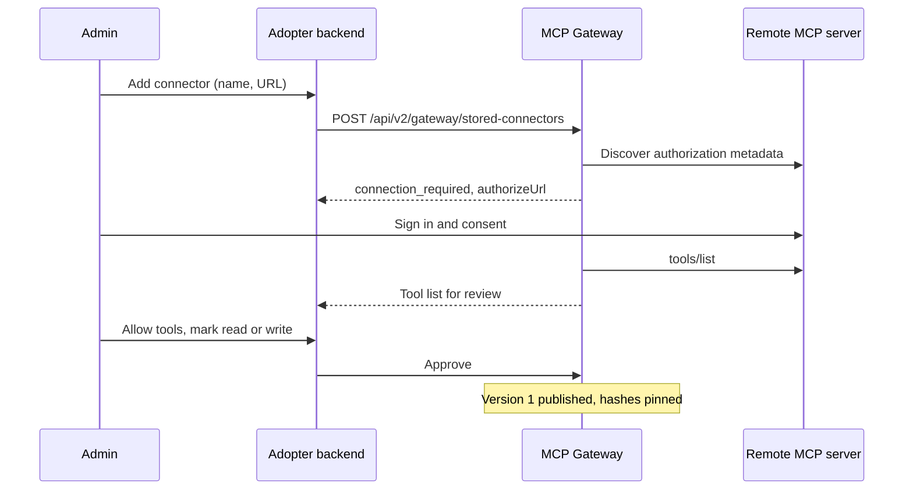

# ADR-071: Bring Your Own MCP Server

**Status**: Proposed
**Date**: 2026-11-13
**Deciders**: Sean Matthews, Daniel Klotz

## Context

[ADR-070](./070-mcp-gateway.md) gives a Frigg app an MCP Gateway. Every remote MCP server it
fronts is a **curated connector**: declared in code as an API module, with a tool allowlist, an
access class per tool and a pinned definition hash, all set by the adopter before release.

Adopters' customers will ask for more than the curated list. Desktop agent clients already let
a person paste a server URL and connect, and people now expect the same from an agent inside a
product they pay for: their own data warehouse, an internal tool, a vendor the adopter has
never heard of. This is "bring your own MCP server".

It cannot be a switch on ADR-070, because three of that ADR's assumptions stop holding when
the server is not known in advance:

1. **Nobody at the adopter reviewed the tools.** The allowlist, the access class and the pinned
   hash all came from that review.
2. **The connector is not in code.** There is no API module to deploy. The record has to be
   created at runtime and stored.
3. **The URL comes from a person.** The gateway is now asked to make requests to a host a
   customer typed in.

This ADR covers servers added by an adopter's **end users**. It does not cover a developer
handing Frigg an OAuth client and sync mappings so Frigg runs a whole integration for them.
That is the subject of ADR-063 (Integration Definitions as Data, proposed in an open pull
request and not yet on `next`). Section 6 sets out how the two relate.

## Decision

Add **stored connectors** to the MCP Gateway: remote MCP servers recorded in the database and
scoped to one organization or one user. Ship them in two steps, organization first.

### 1. Three kinds of connector

| | Curated (ADR-070) | Organization connector | Personal connector |
|---|---|---|---|
| Added by | The adopter, in code | An admin of the organization | Any user |
| Defined in | An API module | A stored record owned by the organization | A stored record owned by the user |
| Who reviews the tools | The adopter, before release | The admin, when adding it | Nobody |
| Access class | Set by the adopter | Set by the admin; `write` until they say otherwise | Always `write` |
| Pinned hash | From the adopter's review | Taken when the admin approves the tool list | Taken on first use |
| Who can call it | Per connector config | Members of that organization | That user only |
| Ships | Version 1 of the gateway | Step 1 of this ADR | Step 2 of this ADR |

Organization connectors come first because they keep a human review step. The reviewer moves
from the adopter to the customer's own admin, who is the right person to decide what their
organization's agent may reach.

### 2. Off by default, and the adopter decides how far it goes

```javascript
mcpGateway({
    connectors: { /* curated, per ADR-070 */ },
    stored: {
        organization: true,     // admins may add servers for their organization
        personal: false,        // users may not add their own
        maxPerOwner: 10,
        allowHosts: null,       // optional allowlist of host suffixes
    },
}),
```

An app that does not set `stored` behaves exactly as ADR-070 describes. Who counts as an admin
is the adopter's call: the adopter's backend states it on the request, the same way it states
the acting user.

### 3. The stored record

One record per stored connector:

| Field | Notes |
|---|---|
| `id`, `name`, `description` | `name` is shown to people and forms the tool prefix |
| `owner` | The organization user or the individual user |
| `url` | The server's MCP endpoint. HTTPS only |
| `clientRegistration` | How Frigg identifies itself to this server: `metadata-document`, `dynamic`, or `provided` |
| `clientCredentialId` | Only for `provided`. Points at a `Credential` row holding the client ID and secret |
| `version`, `checksum` | The reviewed tool list is an immutable version (section 6) |
| `tools` | Per tool: allowed or not, access class (`read` or `write`), pinned hash |
| `status` | `DRAFT` (awaiting review), `PUBLISHED`, `DEPRECATED`, `RETIRED` |
| `drifted` | Set when the live tool list no longer matches the published version |
| `addedBy`, `addedAt`, `reviewedBy`, `reviewedAt` | For audit |

The record never holds a secret. This follows ADR-063, where a definition never holds one and
credentials stay in credential rows.

Each person's sign-in to the server is an ordinary grant: an `Entity` and `Credential` owned by
that user, as in ADR-070 section 4. The stored connector holds the definition. It never holds a
user's token.

`provided` exists because some servers accept only clients registered ahead of time. The admin
registers an OAuth client with the provider and gives Frigg its ID and secret, which Frigg
stores as a credential. This is the one piece of "bring your own OAuth client" this ADR takes
on.

### 4. Adding a server



- `McpRemoteRequester` from ADR-070 is reused unchanged. Discovery and client registration are
  what make an unknown server connectable.
- A connector is a `DRAFT` until its tool list is approved. Approval publishes version 1. No
  tool is served before that.
- For a personal connector there is no review step. Every tool is allowed, classed `write`,
  and pinned on first use.

### 5. Rules for every stored connector

- **Outbound requests are guarded.** Every fetch to a stored URL, including discovery and the
  redirects it follows, goes through the client in ADR-070 section 3: HTTPS only, no private or
  link-local addresses, a response size cap, and the address checked at connect time so a DNS
  change cannot redirect it afterwards.
- **A changed tool is withheld.** If a tool's definition no longer matches its pinned hash, the
  connector is marked `drifted` and that tool stops being served. Accepting the new definition
  publishes a new version. The earlier version stays, so going back is a pin change.
- **Results say they are unreviewed.** `_meta.frigg` carries `source: 'remote'` and
  `curated: false`, with the owner kind. The caller can then apply stricter rules, such as
  confirming every call or refusing to mix this content with a write elsewhere.
- **Names cannot collide.** A stored connector's tools are prefixed with a name the gateway
  makes unique per owner. A stored connector never supersedes a native or curated tool.
- **Limits.** The adopter sets a maximum number of stored connectors per owner, and may
  restrict hosts to a suffix allowlist.
- **Removal is complete.** Deleting a stored connector deletes every grant made against it.
- **Telemetry.** Tool calls emit the same usage events as ADR-070, with the connector marked as
  stored. Adding, approving, re-pinning and removing a connector are audit events.

### 6. How this relates to ADR-063

ADR-063 holds **integration** definitions as data. Its safety argument is that a definition
"cannot reach a module the app didn't register": a data-defined integration only composes
registered, reviewed code, through each module's capability manifest.

A stored connector is the other thing: a **module** defined as data, pointing at a server the
app did not register. ADR-063 does not cover that and its safety argument does not extend to
it. So a stored connector is not an integration definition document, and it does not go in the
`IntegrationDefinitionVersion` table.

It does follow the same patterns, so the two read as one system:

| ADR-063 pattern | Used here as |
|---|---|
| Immutable published versions with a checksum | The reviewed tool list. Re-approving after a change publishes a new version |
| `DRAFT` → `PUBLISHED` → `DEPRECATED` → `RETIRED` | The connector's status |
| Publishing is the review gate | An admin approving the tool list |
| A definition never holds a secret | Client credentials and user tokens live in `Credential` rows |
| Capability manifest entries, `<object>.<verb>` with `kind: read \| write` | A stored connector's tool list has the same shape: a name, an input schema, and a kind. The gateway's access class uses the same two values |
| Ownership by owner `userId` plus `organizationId`, per ADR-056 | Organization and personal connectors use that model, not a second one |

One boundary is kept on purpose: **a data-defined integration cannot call a stored connector's
tools as steps.** Allowing it would let an unreviewed server into sync and workflow runs, which
is exactly what ADR-063 rules out. Stored connectors are reachable only through the gateway,
by an agent, for the acting user.

### 7. API

| Method and path | Purpose |
|---|---|
| `POST /api/v2/gateway/stored-connectors` | Add a server. Returns the record and, if needed, `connection_required` |
| `GET /api/v2/gateway/stored-connectors` | List the acting user's and their organization's stored connectors |
| `GET /api/v2/gateway/stored-connectors/:id/tools` | The live tool list beside the pinned one, for review |
| `PATCH /api/v2/gateway/stored-connectors/:id` | Approve tools, set access classes, accept a changed definition, disable |
| `DELETE /api/v2/gateway/stored-connectors/:id` | Remove the connector and its grants |

The directory endpoint from ADR-070 includes stored connectors, marked as such, so an adopter's
integrations page can show curated and stored connectors in one list. New Management API
resources go under `/api/v2/` per ADR-053.

### Non-goals

- **No public registry or marketplace.** A person supplies a URL. Frigg does not suggest servers.
- **No local or stdio servers.** Remote servers over HTTPS only.
- **No approval logic.** As in ADR-070, confirmation before a write stays in the caller.
- **No developer-defined integrations.** Sync mappings, webhooks and schedules supplied by a
  customer's developer belong to ADR-063.

## Consequences

### Positive

- An adopter's customers can connect the long tail without waiting for the adopter to add it.
- The adopter's product matches what people already do in desktop agent clients.
- The review step survives for organization connectors, held by the customer's own admin.
- The sign-in code, credential store and telemetry from ADR-070 are reused.

### Negative

- The gateway makes requests to hosts a customer chose. The outbound guard becomes a control
  that must not fail.
- Personal connectors have no human review. The only protections are the `write` class, the
  pinned hash and whatever the caller does with `curated: false`.
- Text from an unreviewed server reaches the adopter's agent. The caller's rules for untrusted
  content carry more weight than they do for curated connectors.
- Support load moves to the adopter: a customer's broken server looks like a broken product.
- Classing every personal tool as `write` means the agent asks before every call. That is safe
  and it is slow.

### Neutral

- An app that does not enable `stored` is unchanged.
- ADR-070's statement that server URLs come from module definitions stays true for curated
  connectors.

## Alternatives Considered

1. **Leave it to the adopter.** The adopter builds its own MCP client for customer-supplied
   servers beside the gateway. Rejected for the reason ADR-070 exists: a second credential
   store and a second connect flow.
2. **Curated only, with a fast path for requests.** Customers ask, the adopter adds a module.
   Safe, and right for an adopter with few customers. It does not scale to internal tools only
   one customer has.
3. **Personal connectors first.** It is the model people know from desktop clients. Rejected as
   the first step because it removes review entirely, inside a product where the agent can
   change the customer's records.
4. **Trust the server's own annotations for read and write.** Rejected. The MCP specification
   says tool annotations are hints and are not to be trusted from an untrusted server.

## Related

- [ADR-070](./070-mcp-gateway.md): the gateway, the requester, grants and tool policy this builds on
- ADR-063, Integration Definitions as Data (proposed, not yet on `next`): versions, lifecycle and capability manifests this follows; see section 6
- ADR-056, app profiles, tenancy and entity scopes (proposed, not yet on `next`): the ownership model
- ADR-053, Management API versioning (proposed, not yet on `next`): the `/api/v2/` prefix
- [ADR-011](./011-integration-telemetry-and-usage-tracking.md): usage and audit events
- [ADR-024](./024-global-entities.md): ownership levels
- MCP specification: authorization, and tool annotations as untrusted hints

## Open questions

1. **Is organization-level enough for the first adopters,** or is personal needed from the
   start? Lean: organization first, and decide on personal after seeing what admins add.
2. **Who is an admin?** The adopter's backend asserts it per request today. Should Frigg hold a
   role on the user instead? Lean: keep it asserted; roles are the adopter's domain.
3. **Read tools on organization connectors.** May an admin class a tool as `read` on their own
   judgment, or should a `read` class need the server's `readOnlyHint` as well? Lean: admin's
   judgment, with the hint shown beside each tool during review.
4. **Sharing a personal connector.** Can a user offer theirs to the organization, which then
   goes through admin review? Lean: yes, as a later addition.
5. **Host allowlist by default.** Should a new app start with stored connectors limited to an
   allowlist the adopter fills in? Lean: no allowlist, feature off by default.
6. **Stored connectors inside data-defined integrations.** Section 6 forbids it. Is there a
   case for allowing an organization connector, once an admin has reviewed it, as a module in
   that organization's own definitions? Lean: no, until ADR-063's ownership follow-up lands.
7. **Shared code with ADR-063.** Versioning, checksum and the conditional publish write exist in
   ADR-063's v0.1 use cases. Reuse them directly, or copy the pattern? Lean: reuse, by lifting
   them out of the integration-specific module.
